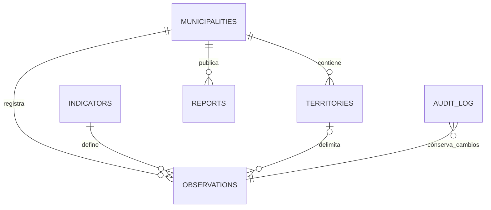

# Donut Alicante: arquitectura y decisiones

## Alcance de la primera entrega

Se separan cuatro cosas que no son intercambiables: definición de un indicador, observación, evaluación frente a un umbral y representación territorial. Un catálogo vacío de observaciones es un estado válido. No hay datos reales, geometrías ni límites precargados. Las fuentes del catálogo son candidatas pendientes de comprobar disponibilidad, acceso y licencia. No hay rastreadores ni consultas automáticas a fuentes estadísticas.

La primera versión es un monolito Next.js 15 / React 19 con TypeScript, ejecutado en Node 24. Un solo despliegue permite comenzar con un coste reducido. React renderiza la interfaz, SVG muestra el donut y las series; Leaflet representa únicamente las geometrías importadas, sin solicitar teselas a terceros. ExcelJS permite importar y exportar XLSX, y CSV es el formato abierto de intercambio.

La aplicación usa SQL parametrizado mediante un adaptador PostgreSQL (`pg`) o SQLite (`node:sqlite`). SQLite permite desarrollar sin servicios adicionales, sobre disco persistente y una única instancia. PostgreSQL 17 y PostGIS 3.5 son el destino de despliegue con varios procesos. No usar SQLite en un sistema de archivos efímero ni compartir un archivo entre máquinas. No se implementa comparación entre municipios.

## Modelo de datos ejecutable

Las tablas se crean en `lib/db.ts`. Cada tabla guarda `id`, `data` (documento JSON validado por Zod) y `revision`. Esta separación permite conservar instantáneas completas de fuente y metodología por observación, aunque cambie el catálogo. No se guarda el dato únicamente en el navegador. `db/postgis.sql` añade columnas relacionales generadas, claves foráneas, unicidad de series e índice espacial en PostgreSQL sin alterar la API. Las validaciones de pertenencia territorial se aplican también en el servidor.

- `municipalities`: código estable, nombre, provincia, país. Alicante: código INE 03014. Catálogo común; cada observación exige municipio.
- `indicators`: identificador, nombre, dimensión, definición, unidad, versión, método, fuente candidata, sentido de evaluación, umbral opcional y referencia justificativa, activo. Catálogo inicial de 15+15+5+5. No hay límites por defecto.
- `territories`: identificador propio, municipio, nombre, nivel (barrio/sección), geometría Polygon/MultiPolygon WGS84, origen, licencia y versión de la delimitación, población opcional. No hay polígonos ficticios. La jerarquía barrio/sección no se presupone: requiere correspondencias oficiales antes de agregar datos.
- `observations`: indicador, municipio, territorio opcional (null = municipal), valor, unidad, periodo (año o mes), fuente original y URL HTTPS, publicación, actualización, método y versión, clasificación (oficial/estimación/simulación), validación (borrador/validado/publicado), licencia y autorización de reutilización, población de referencia, cobertura, incertidumbre y contexto agregado de vivienda opcional.
- `reports`: municipio, título, resumen, texto, enlace de referencia, fecha y estado. Texto plano escapado por React; sin HTML arbitrario.
- `audit_log`: entidad, registro, fecha, antes, después y actor administrativo. Cada guardado incrementa revisión y crea una entrada, en la misma transacción. Las semillas iniciales no son ediciones editoriales. Sin borrado desde el panel.

La clave lógica de serie es municipio + indicador + territorio + periodo. Cambiar unidad, versión, definición o método de un indicador con observaciones requiere otro identificador. Una estimación no pasa por oficial: el campo clasificación es obligatorio y visible. Una simulación no se publica. Las observaciones municipales no se usan para completar barrios o secciones. Los archivos descargables conservan la procedencia y solo incluyen datos publicados con reutilización autorizada.

Fuentes y métodos se editan como metadatos del catálogo y de cada observación. Una biblioteca de fuentes reutilizables con permisos, revisiones y licencias independientes se deja para una siguiente iteración; no se simula una integración institucional.

## Evaluación

La evaluación exige una observación publicada del territorio seleccionado, umbral y referencia, además de sentido min/max. Los indicadores contextuales no se califican. Los estados son: sin dato, sin umbral, cumple o fuera del umbral documentado. El valor se contrasta con el umbral de la definición de la serie; no se calcula una nota global. La revisión humana debe justificar adecuación territorial, temporal y poblacional antes de registrar un umbral. La versión inicial no implementa un comité metodológico ni una revisión por dos personas.

El donut es un anillo interactivo de estados, no un gráfico de distancias a límites ni una implementación completa de las fronteras planetarias. El mapa usa una escala descriptiva relativa a las observaciones del mismo indicador, periodo y nivel; no interpreta verde como sostenibilidad y lo advierte en su leyenda. Un periodo común evita comparar automáticamente el dato reciente de un barrio con un año diferente de otro.

## Administración y seguridad

Un único rol administrador en esta entrega. Contraseña almacenada como hash scrypt, secreto de sesión independiente, firma HMAC, cookie HTTP-only/SameSite Strict, duración ocho horas y Secure en producción. Sin credenciales por defecto. Todas las escrituras comprueban autenticación y origen. Hay limitación básica de intentos por proceso; para varios nodos debe sustituirse por una limitación compartida en el proxy o almacén común y, preferiblemente, OIDC con MFA.

Revisión: guardar borrador → comprobar → guardar validado → publicar. Publicar exige una versión previamente validada y sin cambios. Una corrección de contenido exige nuevo guardado y validación. La importación siempre crea borradores; devuelve éxitos y rechazos por fila (puede ser parcial). No se importan fórmulas de Excel; los textos peligrosos se neutralizan en exportaciones para evitar inyección de fórmulas. Límites: 1,5 MB de archivo, 2 MB de petición, 500 filas. Aplicar también límite de cuerpo en el proxy de producción.

No se incluyen microdatos, direcciones particulares ni identificadores de personas. Anonimización, supresión de celdas pequeñas y autorización de licencias requieren revisión de cada conjunto antes de publicar; una aplicación no certifica automáticamente su legalidad. El contexto de vivienda es agregado, no un registro de hogares.

Accesibilidad: idioma español, navegación semántica, enlace de salto, etiquetas, foco visible, donut por teclado, selección territorial alternativa al mapa, tablas de datos junto a gráficos, estado no comunicado únicamente por color, diseño móvil y reducción de movimiento. Requiere auditoría WCAG completa antes de afirmar conformidad.

## Navegación y diseño visual

- `/`: visión general de Alicante, cobertura de datos, cuatro perspectivas, donut de estados y actualizaciones.
- `/indicadores`: búsqueda y filtros de dimensión, periodo y territorio.
- `/indicadores/[id]`: definición, selección territorial heredada del catálogo, valor, histórico, tabla, fuente, método, limitaciones y CSV filtrado.
- `/territorio`: nivel, indicador, periodo común, mapa de geometrías documentadas y selector accesible.
- `/metodologia`: modelo, leyenda de estados, revisión, fuentes, privacidad y reutilización.
- `/informes`: estudios publicados y descarga del texto, sin diagnósticos ficticios.
- `/descargas`: CSV/Excel de observaciones publicables y catálogo JSON.
- `/admin`: acceso privado, edición, importación, municipios y auditoría.

Paleta marfil y verde bosque, acentos terracota/verde/azul/malva para las cuatro dimensiones, titulares serif y controles sans serif. Tarjetas sobrias, espacio en blanco y mensajes de ausencia de datos legibles. No se usan fotografías decorativas ni cifras inventadas que puedan confundirse con un diagnóstico.

## Fases y criterios de aceptación

1. **Arquitectura y diseño**: esta documentación, catálogo tipado, navegación y esquema. Entregado.
2. **Versión funcional**: web pública, fichas e históricos cuando haya datos; administración, revisión, auditoría, CSV/XLSX. Entregado como base inicial; credenciales reales pendientes de configuración del propietario.
3. **Integración territorial**: renderer y modelo listos. Pendiente localizar delimitaciones oficiales, comprobar licencia/versión, importar y verificar validez topológica y correspondencias. La interfaz permanece vacía hasta entonces.
4. **Datos reales**: pendiente ficha de acceso/licencia por conjunto, descarga manual o conector autorizado, adaptación de unidades/periodos, pruebas de calidad, privacidad y revisión. Primera prioridad sugerida: renta y desigualdad del Atlas del INE, seguidas de inventarios locales, si su licencia y cobertura lo permiten. No se ha consultado ni importado ninguna de estas fuentes.
5. **Evaluación**: lógica de estados entregada. Pendiente acordar y documentar umbrales por indicador, sin trasladar fronteras globales al municipio de forma automática.
6. **Futuro**: más municipios, compatibilidad formal de series (unidades, población, periodo y metodología), comparación y simulaciones. No implementadas.

Antes de publicar en Internet: configurar TLS y credenciales, persistencia y copias de seguridad, aplicar migración PostGIS, ensayar restauración, revisar permisos y procesos editoriales, comprobar licencias, auditar accesibilidad y seguridad del despliegue. Son tareas de puesta en producción, no garantías implícitas de esta entrega.
